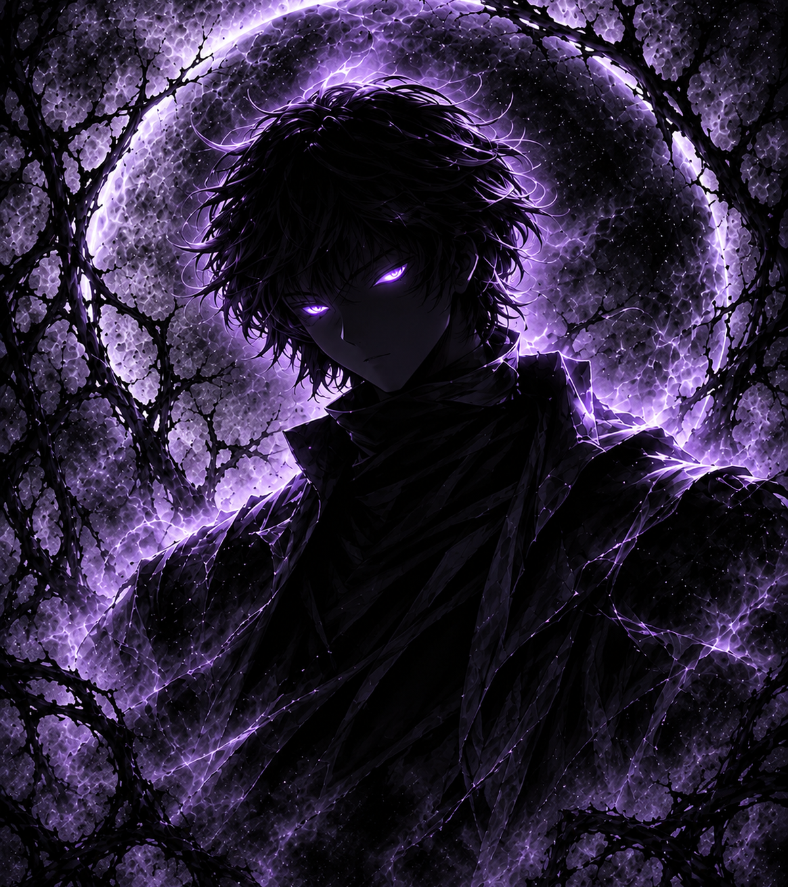
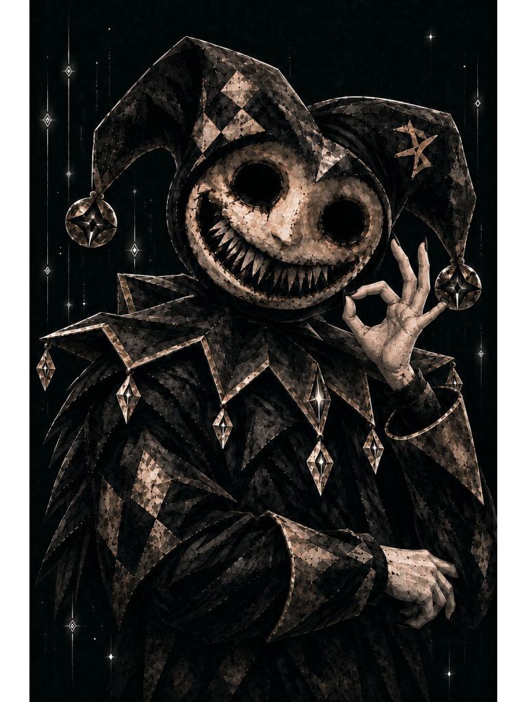
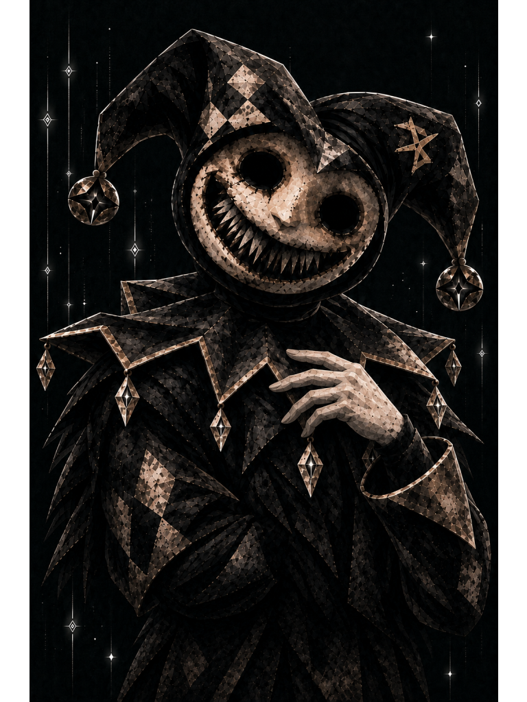
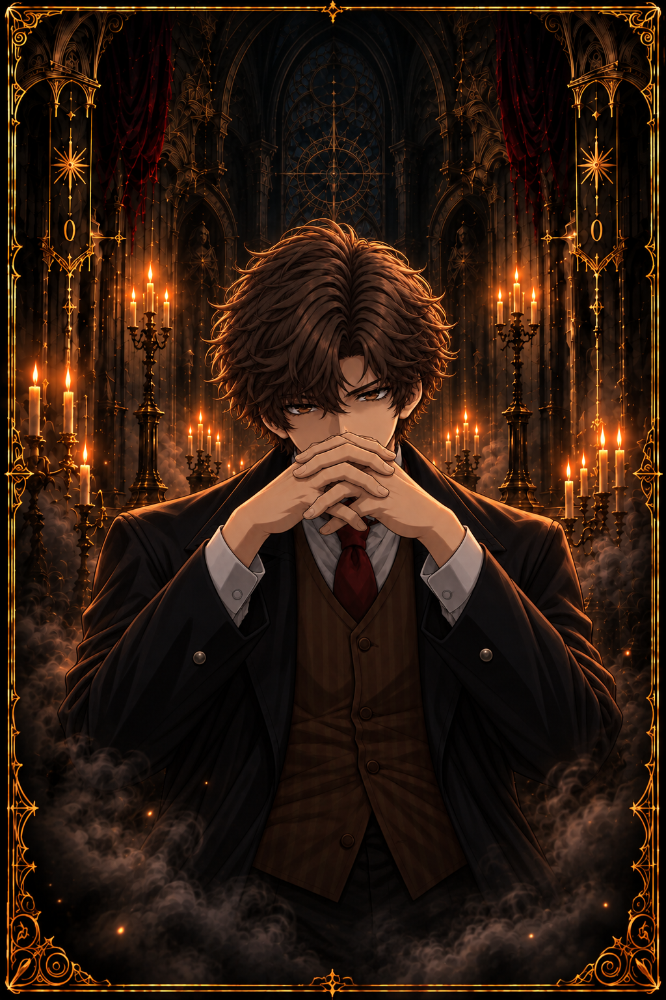
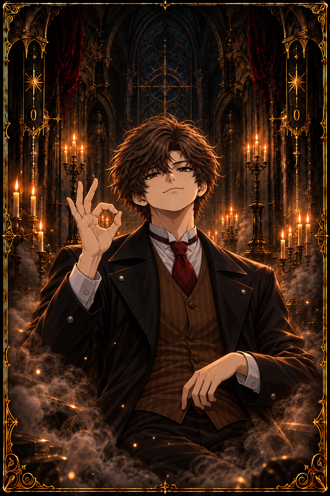
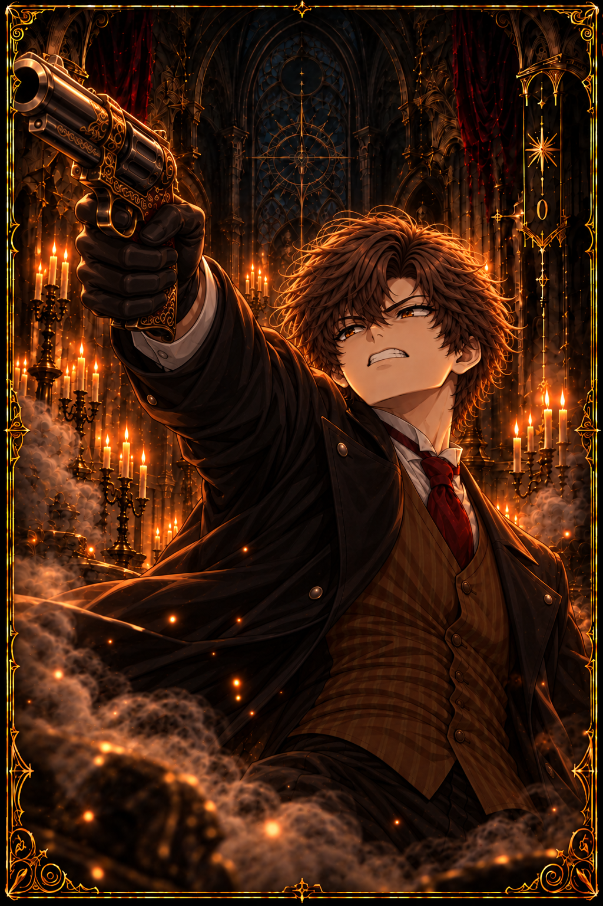
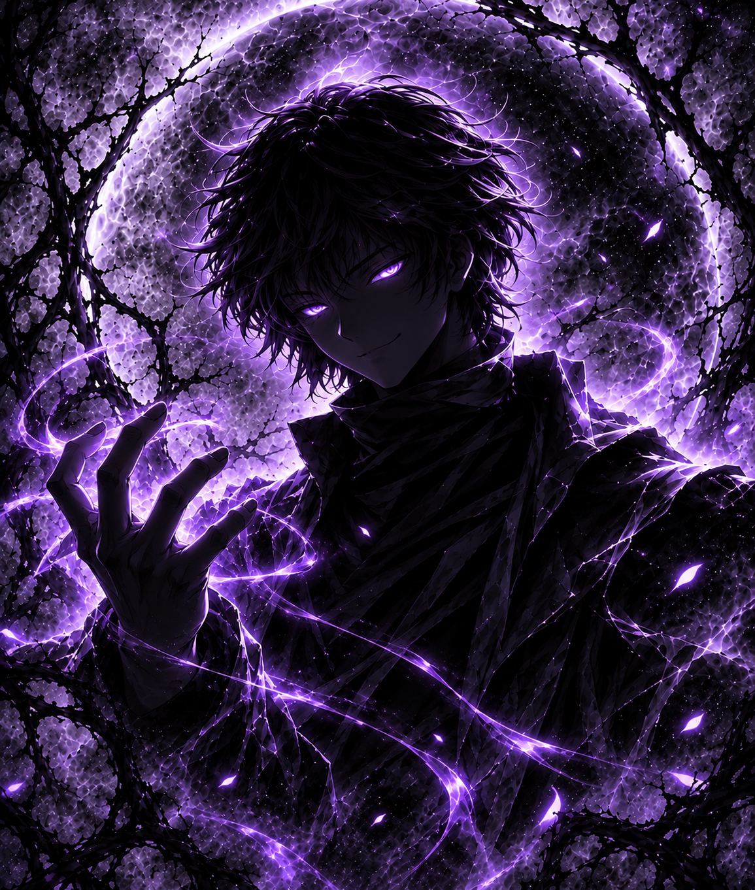
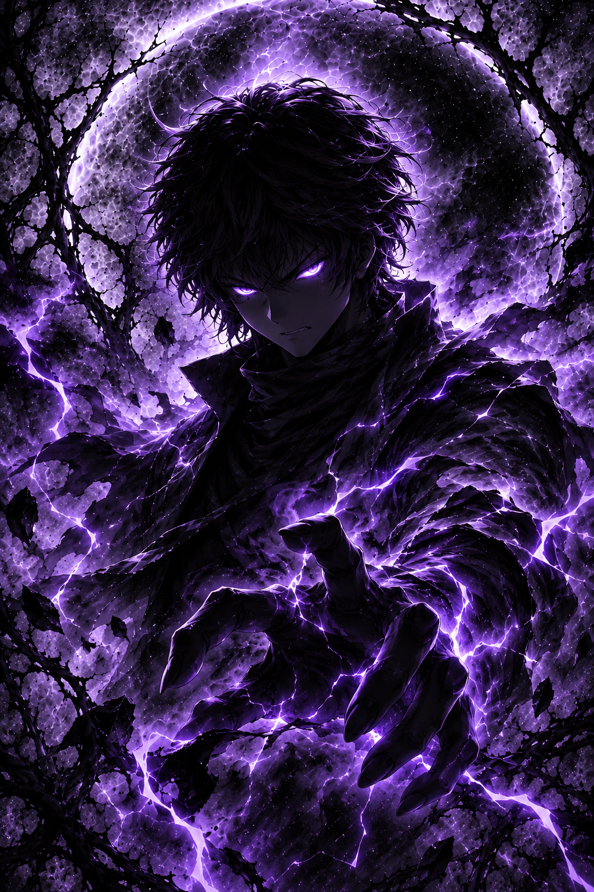
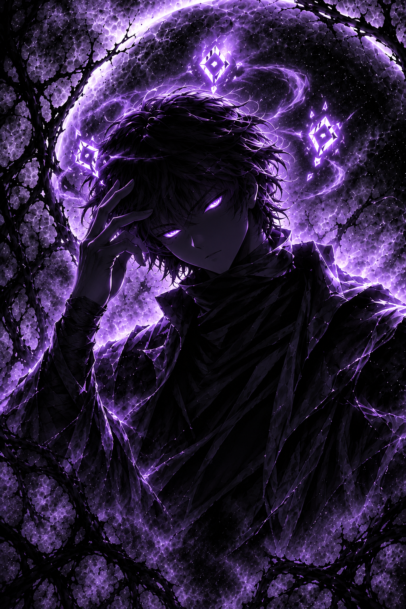
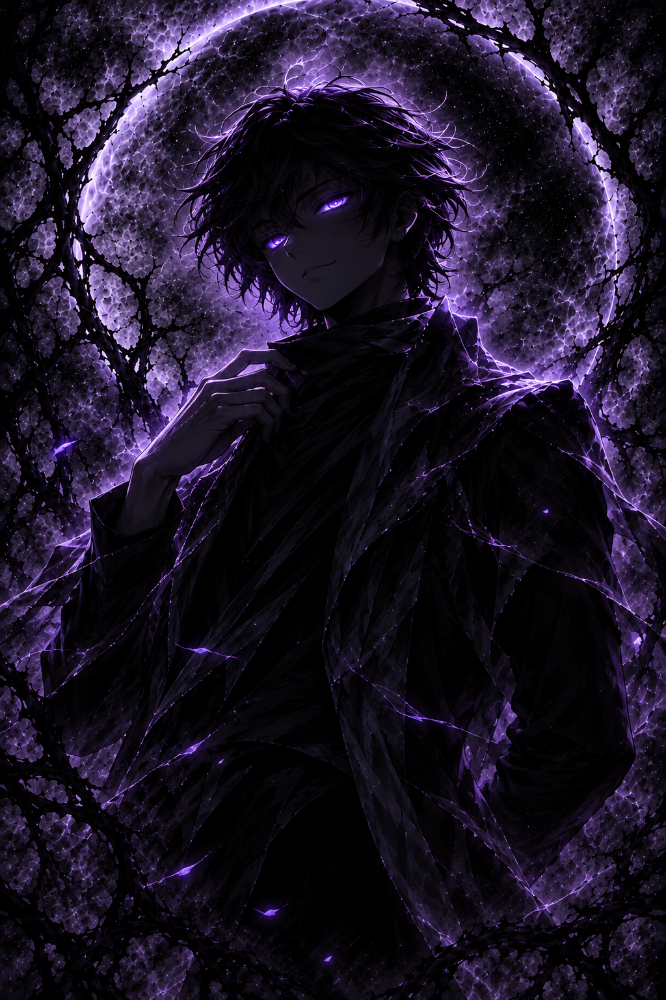

# FOU v2.5 — Crypto Portfolio Tracker

**From a Python terminal experiment to a themed desktop application.**

FOU is a personal cryptocurrency **watchlist and price tracker** built with Python. Add the coins you care about, see their latest available prices, and save your list for next time—all without connecting a wallet or placing a trade.

Version **2.5** introduces a desktop experience built with **CustomTkinter**, three distinct visual themes, responsive ornamental frames, and an illustrated companion that reacts to what happens in the app. The original **command-line interface (CLI)** is still part of the project.

**Project by [FOU-SHREX](https://github.com/FOU-SHREX)** · **Current version: v2.5** · **Created and refined for the Hack Club Stardance project showcase** · **License: MIT (with separate licenses for certain assets)**

> **Release status:** The FOU v2.5 Windows GUI has been built with PyInstaller and its theme/reaction behavior has been tested in Python. The standalone Windows build is **not yet publicly released or runtime-verified** because Windows Smart App Control blocked the unsigned EXE. Trusted signing and distribution are being prepared. **Linux and macOS v2.5 binaries are also pending.** Please do not mistake older V2 downloads for tested v2.5 GUI builds.

## Contents

- [See FOU](#see-fou)
- [Why I built it](#why-i-built-it)
- [The journey: CLI to GUI](#the-journey-cli-to-gui)
- [Features](#features)
- [How feedback shaped FOU](#how-feedback-shaped-fou)
- [Three themes, three companions](#three-themes-three-companions)
- [The six companion emotions](#the-six-companion-emotions)
- [The hardest UI challenge: THE FOOL portfolio frame](#the-hardest-ui-challenge-the-fool-portfolio-frame)
- [Screenshots and demo videos](#screenshots-and-demo-videos)
- [Installation and running from source](#installation-and-running-from-source)
- [How FOU works](#how-fou-works)
- [Testing and reliability](#testing-and-reliability)
- [What I learned](#what-i-learned)
- [AI tools and credits](#ai-tools-and-credits)
- [Limitations and roadmap](#limitations-and-roadmap)
- [License and contributions](#license-and-contributions)

## See FOU

Three themes are available in the **v2.5** theme selector. Each one has its own colors, layout details, companion, and atmosphere; switching themes does not change which coins are in your portfolio.

<table>
  <tr>
    <th>FOU DEFAULT</th>
    <th>THE FOOL</th>
    <th>VOID</th>
  </tr>
  <tr>
    <td align="center"></td>
    <td align="center"></td>
    <td align="center"></td>
  </tr>
  <tr>
    <td align="center"><strong>FOU</strong> · Modern / cosmic</td>
    <td align="center"><strong>MR. FOOL</strong> · Gothic / antique gold</td>
    <td align="center"><strong>NØXAR</strong> · Cosmic void / violet</td>
  </tr>
</table>

*These preview images are loaded directly from the project's companion artwork. Full app screenshots will be added in the [media section](#screenshots-and-demo-videos).*

## Why I built it

FOU is my first serious programming project, and it has grown alongside my Python skills.

I sometimes wanted to check a handful of cryptocurrencies without opening an exchange, searching for each coin repeatedly, or dealing with a full trading dashboard. I wanted something small that would remember my list and show me the prices when I came back.

The first idea was straightforward:

1. Add a symbol such as `BTC`, `ETH`, or `SOL`.
2. Fetch the latest available price.
3. Keep the list saved for the next session.
4. Make the experience faster and more enjoyable over time.

That small idea became FOU. It's still **not a trading platform**: it does not hold funds, connect to a crypto wallet, execute orders, or require you to own the coins you track.

## The journey: CLI to GUI

### Stage 1 — My first Python CLI

FOU started as a terminal-based watchlist. It taught me how to put individual Python concepts together into an actual application: dictionaries, loops, functions, conditional logic, string handling, and reading and writing JSON.

The early CLI could add symbols, view a portfolio, remove coins, and save data. Repeated testing made it more reliable: empty inputs were ignored, symbols were normalized with `.strip().upper()`, and duplicate entries such as `BTC` and `btc` were treated as the same coin.

### Stage 2 — Making the data real

The next challenge was pulling cryptocurrency information rather than maintaining a simple list. FOU gained:

- Symbol validation and market-price retrieval.
- Market-cap-ranked results and readable price formatting, including very small prices.
- A hosted backend that contacts CoinGecko so an API key does not need to be embedded in the desktop client.
- Network-error handling, backend caching, and rate limiting.
- JSON validation so a malformed save file does not crash the app.

This was also when I started thinking about how someone other than me would run the project: Windows releases, Linux archives, GitHub Actions, dependency management, and testing clean downloads rather than just running my own working directory.

### Stage 3 — Building a desktop GUI

Eventually, I wanted FOU to feel like **an actual desktop application**, not a terminal script with a skin on top.

I moved the interface to **CustomTkinter**, used **Pillow** to prepare and render artwork, and kept the underlying portfolio logic in Python. The GUI introduced a visual coin list, search field, Add Coin button, Refresh and Save actions, activity indicator, theme selector, and companion panel.

The first GUI was not the final one. I kept comparing screenshots, running the program, adjusting spacing and scaling, then testing again. A lot of the project became about visual accuracy **and** reliable behavior.

### Stage 4 — FOU v2.5: three finished themes

The current release line focuses on three complete, isolated themes: **FOU DEFAULT**, **THE FOOL**, and **VOID**. Their characters, background illustrations, controls, text styles, frames, and reactions are deliberately different, while the underlying portfolio remains the same.

I also learned to lock completed designs instead of changing everything every time I improved one theme. Improvements to VOID were specifically tested to avoid breaking FOU DEFAULT and THE FOOL.

## Features

### Portfolio and market data

- Add a cryptocurrency by its symbol, with validation against available coins.
- Reject duplicate symbols and ignore blank input.
- View the latest available prices in USD and refresh them on demand.
- Display coins in market-cap-rank order, with readable formatting for tiny prices.
- Remove individual coins using an **×** control on their row.
- Save and reload the portfolio locally; **no wallet connection** required.
- Recover to an empty portfolio when the JSON save file is missing or invalid.
- Show selected-coin and last-updated information.
- Fetch coin logos, crop or mask inconsistent backgrounds, and tint them to suit the active theme.

### Desktop experience

- A themed **Companion** panel with six visual reaction states.
- Three selectable themes, with independent palettes, typography, illustrations, and ornamentation.
- A scrollable Portfolio area with compact, readable rows.
- Search icon that focuses the coin-entry field; Enter can also add a coin.
- Responsive resizing for different window and monitor sizes.
- Loading feedback and disabled controls while requests are in progress.
- A **Help** button that opens a linked video in the browser. The help-video destination can be updated as the tutorial is finished.
- A status/activity area that reports success, failures, and network activity.

## How feedback shaped FOU

I didn't build the interface in one attempt. I worked through feedback, screenshots, regressions, and plenty of small fixes. Some changes looked minor, but made the app noticeably easier to use.

| What I noticed or wanted | What changed |
| --- | --- |
| “Watchlist” felt less suitable for the UI | Renamed the main panel **Portfolio**. |
| The extra Orbital Watchlist section made the layout busy | Removed it and focused on the primary coin list. |
| A separate Remove button took up room | Added a compact **×** on each coin row. |
| Rows needed a clearer focus state | Added a selected-row highlight and selection indicator. |
| The first coin shouldn't be chosen automatically | Left selection empty until the user selects a coin. |
| Refreshing shouldn't arbitrarily change the user's focus | Preserved the active selection when the selected symbol is still available. |
| Coin logos had different shapes and backgrounds | Added automated normalization, circular masking, and theme-based recoloring. |
| The search icon felt decorative instead of useful | Made clicking it focus the input box. |
| Users needed clearer progress while loading | Added **Loading** reactions, activity feedback, and temporary control disabling. |
| Status text alone felt disconnected from the companion | Linked **Idle, Loading, Happy, Angry, Confused, and Proud** to real app events. |
| People needed a way to learn the UI | Added the **Help** button and video-opening behavior. |
| Save and Refresh buttons felt inconsistent between themes | Refined icons, fonts, button borders, and themed ornamental treatments. |
| The interface looked different when maximized or resized | Iterated on layout proportions, render sizes, backgrounds, and frame alignment. |
| Portfolio text and controls were hard to fit inside artwork | Adjusted padding, coin-row spacing, headings, scrollbar, and border geometry. |
| One theme's fixes could affect another | Kept the three completed themes isolated and ran cross-theme regression tests. |

The result is the accumulation of many small decisions rather than just one big redesign.

## Three themes, three companions

### 1. FOU DEFAULT — FOU

The original desktop identity: dark, modern, restrained, with a space-inspired look. **FOU** is the default companion, providing reactions without distracting from the prices and controls.


### 2. THE FOOL — MR. FOOL

A very different atmosphere: **black, antique gold, parchment-like accents, gothic ornamentation, and occult/celestial details**. MR. FOOL belongs in this setting. The theme has a special companion frame and a highly detailed Portfolio border, built to stay aligned as the window size changes.


### 3. VOID — NØXAR

VOID uses **deep purple, black, cold lavender, thorn-like metalwork, and a fractured cosmic-eclipse atmosphere**. NØXAR is a shadowy, quiet character with messy hair and glowing eyes. This theme also introduced the **New Rocker** display font and gothic button-frame artwork.


## The six companion emotions

The companion is not just a static illustration. FOU changes its state in response to the app's actual behavior.

| Emotion | When it appears |
| --- | --- |
| **Idle** | The app is standing by or has returned to its normal state. |
| **Loading** | FOU is contacting the backend, refreshing prices, or checking a coin. |
| **Happy** | A coin is added or removed successfully. |
| **Angry** | You try to add a coin already in your portfolio. |
| **Confused** | A symbol is invalid, input is missing, or a network/data problem occurs. |
| **Proud** | Your portfolio is saved successfully. |

Every released theme has its own companion-art folder. Expand a gallery to see the artwork for each reaction.

<details>
<summary><strong>FOU DEFAULT — FOU's six reactions</strong></summary>

| Idle | Loading | Happy |
|:---:|:---:|:---:|
|  |  |  |

| Angry | Confused | Proud |
|:---:|:---:|:---:|
|  |  |  |

</details>

<details>
<summary><strong>THE FOOL — MR. FOOL's six reactions</strong></summary>

| Idle | Loading | Happy |
|:---:|:---:|:---:|
|  |  |  |

| Angry | Confused | Proud |
|:---:|:---:|:---:|
|  |  |  |

</details>

<details>
<summary><strong>VOID — NØXAR's six reactions</strong></summary>

| Idle | Loading | Happy |
|:---:|:---:|:---:|
|  |  |  |

| Angry | Confused | Proud |
|:---:|:---:|:---:|
|  |  |  |

</details>

*Gallery paths point to the project's reaction PNGs. Before publishing, verify that each file exists and is included in the Git commit.*

## The hardest UI challenge: THE FOOL portfolio frame

**This deserves its own section because it took far more effort than it looks.**

The decorative **Portfolio** border in THE FOOL started as a gold ornamental PNG. Making a static image look right was one thing. Making it actually work around a live, resizable desktop interface was much harder.


### The problems I had to solve

- **The top and bottom edges didn't align** with the Companion frame. A frame could look almost right at one size and be visibly wrong at another.
- **Resizing stretched the decoration.** Enlarging the entire PNG changed the proportions of corners, top ornaments, and side details.
- **The content needed its own safe space.** The Portfolio title, search, button, coin rows, scrollbar, and status area had to fit *inside* the decoration instead of colliding with it.
- **Transparency and layering mattered.** The ornamental frame needed to sit visibly around the UI, not cover interactive elements.
- **Theme isolation mattered.** Fixing THE FOOL could not break FOU DEFAULT or, later, VOID.

### How I approached it

I kept adjusting the border using screenshots and repeated real-window tests, including maximization, restoration, and theme switching. The final Python renderer is more than a normal image resize:

1. **Load the transparent ornament** with Pillow and inspect its alpha channel.
2. **Divide the source into a 5 × 5 grid** so corners and detailed ornament areas can be handled separately from the regions that need to expand.
3. **Reconstruct the frame** at the available Portfolio size while preserving the decorative proportions as much as possible.
4. **Measure the Companion frame's visible horizontal rails** from the image data, then calculate how the Portfolio frame should align vertically.
5. **Adjust the resulting geometry iteratively**, rather than relying on one fixed `y` offset.
6. **Calculate the content-safe area** inside the frame and update layout spacing to keep controls legible.
7. **Re-render on resize**, without changing the other themes' layouts.

This is implemented in the GUI's border-rendering functions, including `build_portfolio_border()`, `get_portfolio_border_vertical_bounds()`, `fit_portfolio_border_to_rails()`, and `render_portfolio_border()`.

### Where Codex helped

I used **OpenAI Codex** while working through this particularly difficult section, especially the Python layout calculations and decorative-border implementation. I also used ChatGPT for debugging discussions, comparisons, and explanations.

The part I value most is the **iteration**: I kept the target design in mind, inspected what the actual GUI produced, reported what still looked wrong, and tested changes until the alignment and sizing were acceptable. Codex was a development tool; it did not replace testing and visual decisions.

**What I learned here:** an attractive mockup is not the same as a responsive working UI. Scaling math, alpha compositing, widget geometry, drawing order, and small layout changes all matter.

<!-- OPTIONAL: After adding a polished close-up screenshot, uncomment the next line:

-->

## Screenshots and demo videos

I want people to see the progression, not just the final result. The README is ready for screenshots and short videos of the CLI, each theme, and the companions.

### Screenshot showcase

**Planned screenshots:**

| Moment | What the image should show |
| --- | --- |
| Original CLI | The terminal menu and first working add/view/save flow. |
| Improved V2 CLI | Live prices, portfolio sorting, and a real response from the backend. |
| FOU DEFAULT | The full working GUI with the original companion. |
| THE FOOL | Full antique-gold GUI with Portfolio and Companion frames in view. |
| THE FOOL border close-up | The ornamental Portfolio frame that took repeated geometry fixes. |
| VOID | Full deep-purple GUI with NØXAR and the thorn frames. |
| Emotion montage | At least one sequence showing Loading, Happy/Angry, and Proud. |

<!-- Screenshot embeds: Uncomment each line after the corresponding file exists in docs/media/screenshots/.


-->

### Video walkthroughs

**Planned demonstrations:**

1. **FOU in 60–90 seconds:** Add a coin → refresh → change theme → save → reopen.
2. **CLI to GUI:** The early terminal app next to the v2.5 desktop UI.
3. **Three-theme tour:** FOU DEFAULT → THE FOOL → VOID, including resizing.
4. **Companion reactions:** Loading, Happy, Angry, Confused, Proud, and return to Idle.
5. **THE FOOL border breakdown:** The target, the misaligned attempts, and the final responsive frame.

> **To add a video to GitHub's README:** Upload it to a video host such as YouTube and link a screenshot thumbnail to the video. GitHub also supports uploaded video assets in certain contexts, but regular Markdown links and thumbnail links are the most dependable README presentation. See the [media setup guide](#adding-your-own-media).

<!-- Video thumbnail/link template: uncomment and replace VIDEO_URL once a real video is online.
[](VIDEO_URL)
-->

### Adding your own media

Create this structure in the repository whenever the screenshots and videos are ready:

```text
docs/
└── media/
    ├── screenshots/
    │   ├── cli-v1.png
    │   ├── cli-v2.png
    │   ├── fou-default.png
    │   ├── the-fool.png
    │   ├── the-fool-border-detail.png
    │   └── void.png
    └── videos/
        └── (optional local video clips)
```

For screenshots, save the files with the names above, then uncomment the matching image lines. For videos, upload the finished clip, replace `VIDEO_URL` with its real URL, and uncomment the linked thumbnail. **Do not commit draft videos or screenshots showing personal file paths, keys, or portfolio details you don't want public.**

## Installation and running from source

### Downloadable applications — v2.5 release in preparation

The intended distribution options are:

| Platform | Intended file | Status |
| --- | --- | --- |
| Windows portable | `FOU-v2.5-Windows.zip` | GUI build exists; unsigned EXE blocked by Smart App Control on the development PC; public release pending signing and runtime verification. |
| Windows installer | `FOU-v2.5-Setup.exe` | Planned; not built or signed yet. |
| Linux | `FOU-v2.5-Linux.tar.gz` | v2.5 build and clean-system test pending. |
| macOS | `FOU-v2.5-macOS.zip` | v2.5 build and Mac runtime test pending. |

When verified artifacts are published, find them on the [GitHub Releases page](https://github.com/FOU-SHREX/FOU/releases). **A ZIP download is not a single EXE:** for the portable Windows release, extract the complete folder and keep its `_internal` contents alongside `FOU.exe`.

### Run the desktop GUI with Python

This is the current path for developers and source-code testers. The v2.5 development environment uses Python **3.14.6**; a recent Python version supporting the project's syntax is recommended.

```powershell
# Run from the repository root in Windows PowerShell
py -m venv .venv
.\.venv\Scripts\python.exe -m pip install customtkinter pillow requests
.\.venv\Scripts\python.exe gui.py
```

On Linux/macOS, create and activate a virtual environment and use the equivalent `python3 -m pip install customtkinter pillow requests` / `python3 gui.py` commands. Linux users may need system Tk packages.

### Run the original CLI

```powershell
.\.venv\Scripts\python.exe main.py
```

The CLI uses a numbered terminal menu to add, view, remove, and save coins. It is still useful for understanding FOU's beginnings and testing the portfolio logic separately from the GUI.

### Beginner's quick start

In the **GUI**, type a symbol such as `BTC` into the entry field and click **+ Add Coin**. Once it appears in the Portfolio, try **Refresh**, switch between the three themes, and click **Save**. The companion responds to each operation.

The CLI uses numbered menu options instead of GUI buttons. In that mode you can add multiple symbols, enter `DONE`, and select **View Portfolio** to display prices.

For example, the CLI can show data in a format like this (*illustrative values, not live quotes*):

```text
--------- PORTFOLIO --------
#    COIN     | PRICE
----------------------------
1.   BTC      | $81,000.00
2.   ETH      | $2,600.00
```

## How FOU works

```text
FOU GUI (gui.py) / FOU CLI (main.py)
             │
             ├── Local save_portfolio.json
             │
             └── HTTPS requests
                     │
                     ▼
                FOU backend
                     │
                     ▼
             CoinGecko market data
```

The desktop GUI imports portfolio logic from `main.py`. Market requests go through the hosted FOU backend rather than putting a private CoinGecko API credential into the desktop executable. The backend is intended to use caching and rate limiting to reduce unnecessary external requests.

**Your saved portfolio contains coin symbols and CoinGecko IDs—not purchased quantities, wallet keys, or assets.**

### Where saved portfolios live

- **Python source run:** `save_portfolio.json` in the project folder.
- **Packaged Windows application:** `%LOCALAPPDATA%\FOU\save_portfolio.json`.
- **Packaged Linux application:** `~/.local/share/FOU/save_portfolio.json` by default, or `$XDG_DATA_HOME/FOU/save_portfolio.json` when `XDG_DATA_HOME` is set.
- **Packaged macOS application:** `~/Library/Application Support/FOU/save_portfolio.json`.

Packaged builds use a user-writable data directory so that replacing the application files doesn't automatically remove your watchlist. An old portable release that saved beside the executable does **not** migrate automatically.

## Testing and reliability

I test both the **portfolio behavior** and the **interface behavior** because a pretty theme is not enough if the underlying app is unreliable.

### Portfolio regression checks

- Add multiple valid symbols; reject invalid and empty symbols.
- Attempt to add the same symbol twice and with different capitalization.
- Refresh and inspect price ordering, symbols, coin labels, and logos.
- Remove a coin and confirm it disappears without disturbing other rows.
- Save, close, reopen, and check persistence.
- Test malformed save structures (for example, a JSON list or an invalid/null coin ID) and recover without crashing.
- Check behavior when the backend cannot be reached.

### GUI and theme regression checks

- Switch **VOID → THE FOOL → FOU DEFAULT → VOID**.
- Verify correct companions, colors, fonts, frames, and button decoration for each theme.
- Resize and maximize/restore the window, checking panel alignment and readable rows.
- Test Add Coin, Refresh, Save, Help, and selection behavior.
- Confirm the current portfolio remains consistent while changing themes.

**v2.5 verification so far:** the six VOID reaction states and the three-theme regression checks passed in the Python GUI. PyInstaller completed the Windows standalone build, but Windows Smart App Control blocked the unsigned executable before runtime testing. Public installers and other OS artifacts should only be marked verified after clean-system tests.

## What I learned

FOU became much bigger than my original plan. The biggest lessons weren't just about syntax—they came from trying to make something complete enough for other people to use.

| Area | What FOU taught me |
| --- | --- |
| **Python fundamentals** | Functions, loops, dictionaries, normalization, state, and breaking a big problem into small operations. |
| **JSON and local persistence** | Reading/writing data, checking structure, rejecting malformed inputs, and thinking about save paths. |
| **APIs and backends** | HTTP requests, timeouts, backend responsibilities, hosted services, caching, and keeping keys out of public desktop code. |
| **Error handling** | Distinguishing invalid symbols, duplicates, empty input, network failures, and corrupted files without crashing. |
| **GUI architecture** | Keeping backend logic separate from UI code and updating widgets in response to actions. |
| **Background work** | Threads and queues for network operations so the desktop interface stays responsive. |
| **Image processing** | Alpha masks, cropping, fit/contain behavior, tinting, compositing, and using PNG assets in Pillow. |
| **Responsive layout** | Pixel dimensions, UI scaling, alignment, widget geometry, and testing on different window sizes. |
| **Advanced frame rendering** | Splitting borders into regions, preserving ornaments, detecting visible rails, and coordinating artwork with content. |
| **User experience** | Making small choices—an × button, a clickable search icon, feedback animations, or a Help button—matter. |
| **Visual design** | Building three distinct, consistent identities rather than recoloring the same screen. |
| **Testing discipline** | Retesting old features after each design change and separating successful packaging from successful runtime behavior. |
| **Packaging and release engineering** | Virtual environments, PyInstaller specs, Windows binaries, Linux archives, GitHub, and signing/trust issues. |
| **Working with AI tools** | Explaining a problem clearly, reviewing generated solutions critically, testing the results, and knowing when to iterate. |

I started by asking, *“Can I make this work in the terminal?”* and eventually found myself asking, *“Will the panel line up at every size, will the companion react correctly, and will another person be able to install it?”* That progression is what makes FOU meaningful to me.

## AI tools and credits

I used AI as part of the **development process**, especially **ChatGPT** and **OpenAI Codex**, along with other AI image-generation tools.

- **ChatGPT:** Learning concepts, discussing features, troubleshooting Python errors, reviewing implementation ideas, preparing image prompts, planning the UI, and documenting the project.
- **Codex:** Assistance with code-level work, notably the difficult **THE FOOL Portfolio border** rendering and layout calculations.
- **AI image-generation tools:** Creating or refining theme artwork, companions, emotions, backgrounds, ornaments, logos, and icons.
- **My role:** Deciding the direction, giving feedback, comparing target and actual screenshots, modifying/integrating code, testing behavior, and choosing when a design was finished.

AI assistance is acknowledged rather than hidden. The project was developed through repeated **human direction, implementation, and testing** alongside those tools.

### Visual assets and licenses

FOU-controlled project artwork is documented in [`ASSET_LICENSES.md`](ASSET_LICENSES.md). The **New Rocker** typeface is distributed under the SIL Open Font License 1.1, with its text in [`assets/ui/void/OFL.txt`](assets/ui/void/OFL.txt). Third-party cryptocurrency symbols/logos retain their own owners' rights. AI-generated artwork is covered by the project's MIT grant only to the extent the creator controls licensable rights; redistribution also depends on the relevant generation services' terms.

## Limitations and roadmap

### Current limitations

- FOU is a watchlist, **not** a portfolio wallet or trading platform.
- Latest prices depend on internet access, the hosted backend, and third-party market-data availability.
- A free-hosted backend may be slow to respond after inactivity.
- Saves are local to each device; FOU does not currently synchronize across devices.
- A v2.5 Windows EXE has been built but is **unsigned**, and Smart App Control has blocked its execution on the development PC. Code signing is being explored through **SignPath Foundation**; approval is not guaranteed.
- The **v2.5** Linux and macOS desktop artifacts are not yet validated. Earlier V2 CLI packaging work is not proof that the v2.5 GUI builds work on those operating systems.

### Future ideas (not released features)

- Price alerts and notifications.
- Telegram bot integration.
- More portfolio and market context.
- Additional planned themes such as Terminal, Frost, and Neon after they're complete and tested.
- More helpful tutorials, demo videos, and community-driven accessibility improvements.

## License and contributions

FOU's original source code is distributed under the [MIT License](LICENSE), subject to the separate rights and terms described in [ASSET_LICENSES.md](ASSET_LICENSES.md).

**Feedback is welcome.** If you find a bug, have a UI suggestion, or want to help improve the project, open an [issue](https://github.com/FOU-SHREX/FOU/issues). Include your operating system, what you expected, what happened, and a screenshot or steps to reproduce when possible.

**Repository:** https://github.com/FOU-SHREX/FOU  
**Creator:** FOU-SHREX  
**Version:** **2.5**

---

*FOU started as a small Python CLI. Every bug report, design revision, failed border alignment, and successful test helped turn it into a desktop project I could share.*
